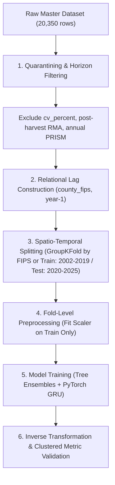

# ✅ FINAL PRE-MODEL CHECKLIST & TECHNICAL GATING SPECIFICATION

**Project:** Regional Maize/Corn Grain Yield Prediction (2002–2026)  
**Location:** `E:/ml do not open/Maize_Yield_Research_2002_2026/09_Independent_Validation/`  
**Purpose:** Strict Quality-Gate Verification before Model Training Commences  

---

## 🛑 MANDATORY GATING CRITERIA (ALL MUST BE SATISFIED)

Prior to running training scripts (`XGBoost`, `Random Forest`, `PyTorch GRU`, or `Super-Learner`), the pipeline must pass all ten verification checks below:

| Check # | Requirement | Status | Verification Protocol |
| :---: | :--- | :---: | :--- |
| **G-01** | **`cv_percent` Purged from Predictors $X$** | ⚠️ REQUIRES ACTION | Verify that `cv_percent` does NOT appear in `X_train.columns` or `X_test.columns`. Must remain only in metadata. |
| **G-02** | **Zero Post-Harvest Leakage** | ⚠️ REQUIRES ACTION | Verify absence of `rma_postharvest_*`, `state_progress_postharvest_harvested_w44_pct`, `noaa_prcp_annual_in`, and `prism_*` from within-season feature matrices. |
| **G-03** | **Spatio-Temporal Cross-Validation Setup** | ⚠️ REQUIRES ACTION | Enforce `GroupKFold(n_splits=5, groups=df['county_fips'])` or strict temporal split (Train: 2002–2019, Test: 2020–2025). Naive random `train_test_split` is strictly banned. |
| **G-04** | **True Calendar Year Lag Joins** | ⚠️ REQUIRES ACTION | Any lag feature ($t-1, t-2$) must be constructed via relational join on `(county_fips, year - 1)`. Naive `.shift(1)` is prohibited. |
| **G-05** | **Zero Data Leakage Preprocessing** | ⚠️ REQUIRES ACTION | `StandardScaler`, `SimpleImputer`, and target transformations must be fit exclusively on training folds (`scaler.fit(X_train)`), never on the full combined dataset. |
| **G-06** | **PRISM 2023 Precipitation Blackout Handled** | ⚠️ REQUIRES ACTION | Ensure models either drop `prism_ppt_mm` or impute the missing 2023 values using NOAA growing-season rainfall. |
| **G-07** | **Zero-Label County Filtering for Prospective 2026** | ⚠️ REQUIRES ACTION | The 26 non-commercial agricultural counties with 0 historical observations (e.g., Cuyahoga OH, Ozark MO) must be masked out from prospective 2026 yield predictions. |
| **G-08** | **High-Yield Tier Log-Transform or Weighting** | ⚠️ REQUIRES ACTION | Apply `np.log1p(yield)` transformation or sample-weighting on observations $>160\text{ bu/acre}$ to prevent negative $R^2$ on extreme yield distributions. |
| **G-09** | **PyTorch Target Scaling & Inverse Transform** | ⚠️ REQUIRES ACTION | When training neural networks (GRU / MLP), fit independent `StandardScaler` for $y_{\text{train}}$, clip gradients at `max_norm=1.0`, and inverse-transform $\hat{y}$ prior to computing evaluation metrics. |
| **G-10** | **Physical Unit Consistency Confirmed** | ✅ VERIFIED | SoilGrids properties confirmed in standard physical units (% for clay/sand/silt/soc, standard pH, $\text{g/cm}^3$ for bulk density). Data Dictionary descriptions updated. |

---

## 📋 PRE-TRAINING EXECUTION SEQUENCE

---

## 🎯 DEFINITION OF DONE FOR EXPERIMENTAL RUNS

A model run is officially considered scientifically validated only when:
1. All 10 gating checks above are marked **PASSED**.
2. Test $R^2$, RMSE, and MAE are evaluated on completely unseen out-of-sample years (2020–2025) or unseen county clusters.
3. Slice analysis confirms non-negative $R^2$ across all three yield tiers ($<120$, $120–160$, and $>160\text{ bu/acre}$).
4. The prospective 2026 inference outputs are restricted to the 788 historically active commercial counties.
